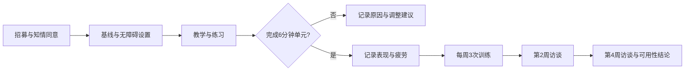

# M1 注意与处理速度训练单元：可用性研究协议

## 1. 阶段目标与边界

M1 只回答：中老年用户能否安全、理解并持续完成一个 5–8 分钟的注意与处理速度训练单元。主要指标是可用性、完成、留存、疲劳和训练内表现变化。本阶段不测量脑部变化、MCI、痴呆或阿尔茨海默病发生，也不作疾病预防宣称。

目标用户为 60 岁及以上、能够独立使用手机或平板、视听能力经基本辅助后可完成任务、无正在影响测试的急性疾病者。出现持续认知快速下降、明显视觉/听觉障碍或无法理解说明时，停止测试并建议寻求专业评估。

## 2. 训练单元

一次训练约 6 分钟：说明与练习 60 秒、正式任务 4 分钟、主观反馈 60 秒。核心任务是“目标出现时点按”：屏幕连续出现单个图形或数字，用户只在目标刺激出现时点击；非目标刺激不点击。每轮记录反应时、命中、漏报和误报。

难度按表现调整：连续两轮命中率≥85%且误报≤10%，缩短刺激间隔或增加干扰；命中率<70%或主观困难≥4/5，延长间隔、减少干扰并提供练习；任何情况下优先保证可理解性和舒适度，不以最快速度作为唯一目标。

## 3. 无障碍与体验要求

支持大字号、高对比度、横屏、音效开关、语音说明、触觉反馈、重复说明和暂停。按钮至少 44 px；避免颜色单独承载规则；提供“我需要休息”和“退出训练”。反馈使用中性语言，例如“这轮完成了 18 个目标”，不使用失败、退化或疾病暗示。

## 4. M1 研究设计

建议招募 12–20 名目标用户，进行 4 周单臂可用性测试。第 0 周完成基线和教学；第 1–4 周每周 3 次、每次 1 个单元。第 2 周和第 4 周进行简短访谈。研究人员记录观察到的误解、辅助请求、暂停和退出原因。

主要指标：首次任务完成率≥80%；每周至少完成 2 次的参与者比例；第 4 周仍完成测试的比例；单次中途退出率；疲劳和挫败感平均分≤3/5。探索指标：训练内命中率、误报率、反应时中位数、练习到正式任务的改善。

## 5. 四周流程

## 6. 数据字段

每次训练记录：`participant_id`、`session_id`、`week`、`device`、`font_scale`、`contrast_mode`、`audio_enabled`、`stimulus_interval`、`target_count`、`hits`、`misses`、`false_alarms`、`reaction_time_median_ms`、`pause_count`、`completed`、`exit_reason`、`fatigue_1_to_5`、`frustration_1_to_5`、`assistance_requests`、`adverse_event`。

只保存研究所需的最小化数据；参与者编号与身份信息分离保存。未经单独同意，不采集通讯录、精确位置、麦克风或摄像头数据。

## 7. 通过与迭代规则

达到主要指标且没有未解决的严重可用性问题，进入 M2 认知近迁移研究；未达到时只修改说明、无障碍和难度，不解释为认知训练无效。任何严重不良事件、持续头晕、视觉不适或明显情绪困扰都暂停训练并转交研究负责人。
